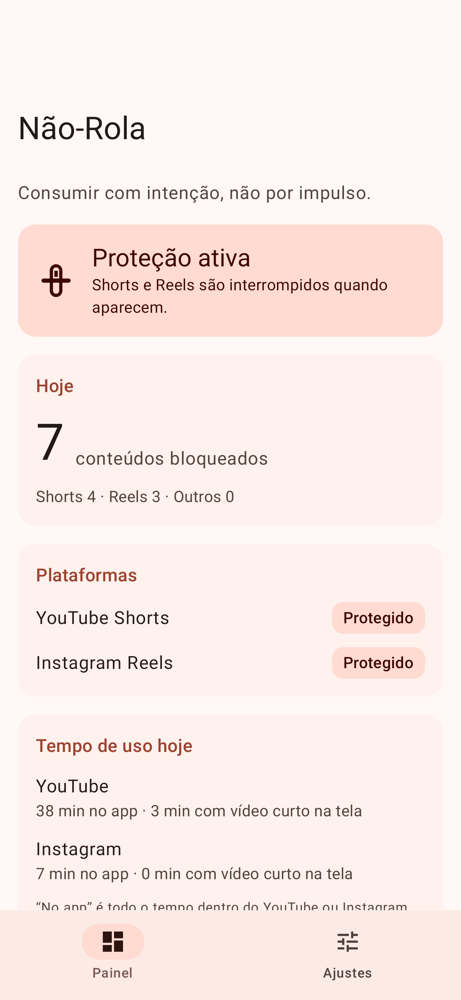
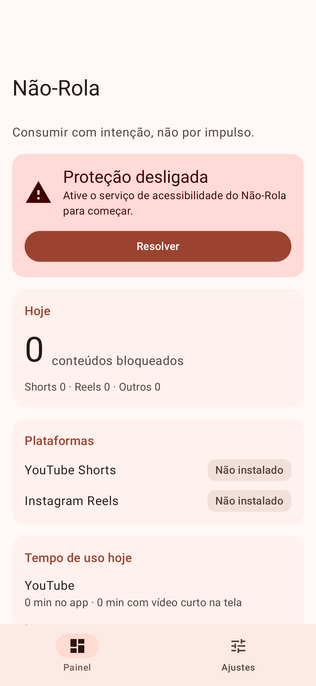
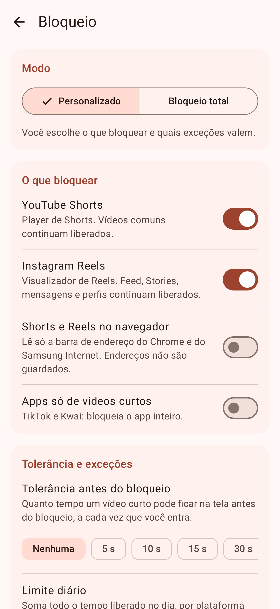
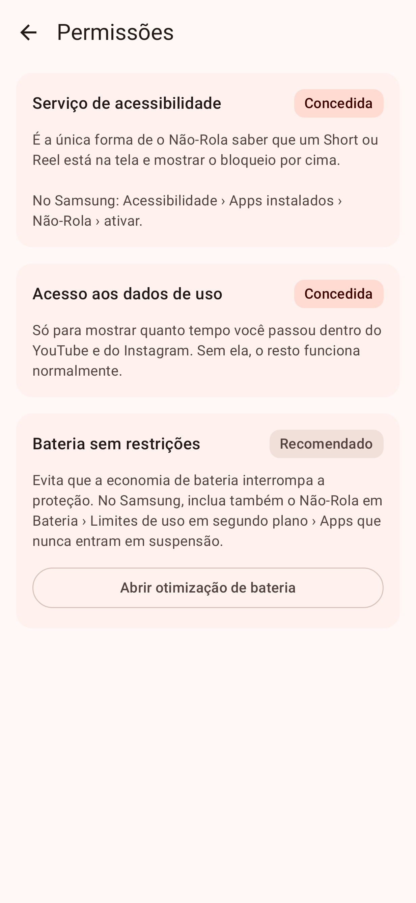
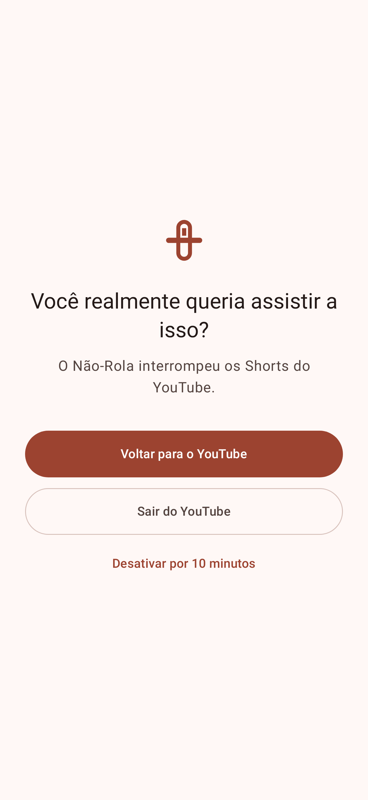
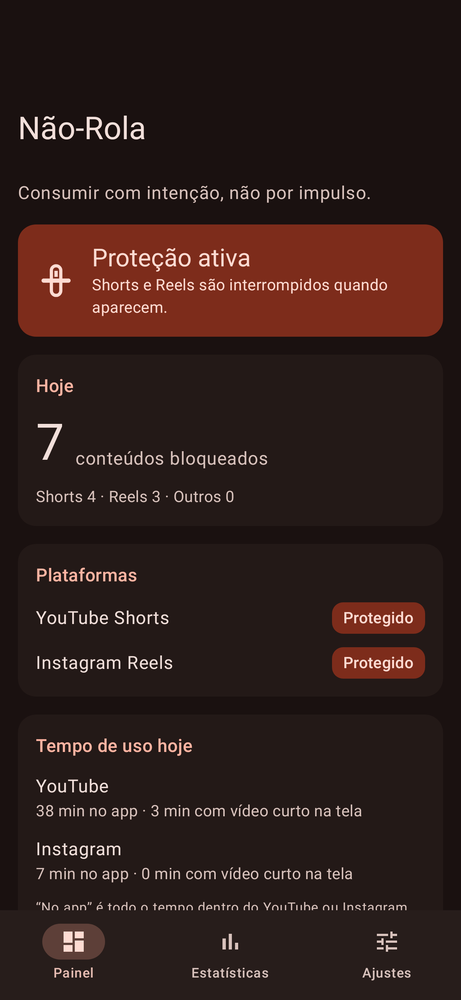

# Não-Rola

Aplicativo Android que interrompe **YouTube Shorts** e **Instagram Reels** para que você continue usando essas plataformas para o conteúdo que escolheu ver, sem cair na rolagem infinita.

> **Consumir com intenção, não por impulso.**

> **APK:** [`release/NaoRola-0.1.0.apk`](release/NaoRola-0.1.0.apk) (2,4 MB, Android 12+). SHA-256: `6de0b011bc2ca488e0a906027da52a870424e5c401c1425771bc0cadcf3219aa`

## Estado atual: MVP, ainda sem calibração

A versão 0.1.0 é o primeiro APK instalável. **Ela ainda não foi testada num aparelho real.** Os identificadores de tela que os detectores procuram vêm de fontes públicas e de análise estrutural. Eles precisam ser confirmados com o **modo diagnóstico** num Android com YouTube e Instagram atualizados (veja [Calibração](#calibração)).

| Parte | Situação |
|---|---|
| Serviço de acessibilidade, tela de bloqueio, pausa, tolerância, Bloqueio total | Implementado e testado em testes automatizados |
| Detecção do player de Shorts e do visualizador de Reels | Implementada; **regras candidatas, a calibrar** |
| Shorts/Reels no navegador (Chrome, Samsung Internet) | Implementado (opcional); id da barra do Samsung Internet a confirmar |
| Apps só de vídeo curto (TikTok, Kwai) | Implementado (opcional), por nome de pacote |
| Painel: status, bloqueados hoje, tempo no app, tempo com vídeo curto | Implementado |
| Modo Disciplina, horários e exceções | Lógica pronta e testada; **telas na Fase 4** |
| Reels dentro do feed, prateleira de Shorts | **Fase 4**, depende de capturas reais |
| Estatísticas de 7 dias, estimativa de exposição evitada | **Fase 4** |

## Capturas de tela

Geradas a partir do app real, com Robolectric e dados de exemplo.

| Painel (ativo) | Painel (desligado) | Bloqueio | Permissões | Tela de bloqueio | Escuro |
|---|---|---|---|---|---|
|  |  |  |  |  |  |

---

## Instalação no Galaxy S26

Desde 30/09/2026, no Brasil, o Android exige que APKs instalados fora de lojas venham de desenvolvedores registrados no Google. **A instalação por `adb` não é afetada**, por isso é o caminho recomendado.

### Opção A: pelo computador, com `adb` (recomendada)

1. No celular: *Configurações › Sobre o telefone › Informações de software*, toque 7 vezes em **Número de compilação** para liberar as Opções do desenvolvedor.
2. *Configurações › Opções do desenvolvedor* › ative **Depuração USB**.
3. Se o **Auto Blocker** estiver ativo (*Configurações › Segurança e privacidade › Auto Blocker*), desative-o temporariamente. Ele bloqueia comandos via cabo USB.
4. Conecte o cabo, aceite a autorização no celular e rode:

```bash
adb install -r release/NaoRola-0.1.0.apk
```

### Opção B: pelo arquivo

Copie o APK para o celular e abra no **Meus Arquivos**. Dependendo da liberação da verificação de desenvolvedor no seu aparelho, o Android pode exigir o *fluxo avançado* (uma espera única de 24 h) ou recusar a instalação. O Auto Blocker também precisa estar desligado.

### Atualizações

Versões futuras precisam ser assinadas com a **mesma chave** para instalar por cima e manter configurações e histórico. A chave não fica no repositório (veja [Assinatura](#assinatura)).

---

## Primeiro uso: permissões

O app mostra cada permissão, explica para que serve e abre a tela certa do Android (*Ajustes › Permissões*).

| Permissão | Obrigatória? | Por quê |
|---|---|---|
| **Serviço de acessibilidade** | Sim | É a única forma de saber que um Short ou Reel está na tela e mostrar o bloqueio. O app só observa os apps cuja proteção está ligada. |
| Acesso aos dados de uso | Não | Só para mostrar o tempo total dentro do YouTube e do Instagram. |
| Bateria sem restrições | Recomendado | Evita que a economia de bateria interrompa o serviço. |

Passo a passo no S26:

1. Abra o Não-Rola e toque em **Resolver** (ou *Ajustes › Permissões*).
2. Leia o aviso e toque em **Entendi, abrir configurações**. Vá em *Acessibilidade › Apps instalados › Não-Rola* e ative.
3. **Se aparecer "configuração restrita"** (comum em APK instalado por arquivo): volte, abra *Configurações › Apps › Não-Rola*, toque em **⋮ › Permitir configurações restritas** e ative de novo.
4. Opcional: em *Permissões › Acesso aos dados de uso*, ative o Não-Rola.
5. Recomendado: em *Configurações › Bateria › Limites de uso em segundo plano › Apps que nunca entram em suspensão*, adicione o Não-Rola.

**Proteção Avançada (Android 17 / One UI 9):** com ela ligada, o Android só permite serviços de ferramentas de acessibilidade. O Não-Rola não é uma e não se declara como tal, então não funciona nesse modo. O app detecta e avisa.

É esperado que o Android lembre de tempos em tempos que o app "pode ver e controlar a tela".

---

## Calibração

Esta é a etapa que transforma regras candidatas em regras confirmadas.

1. Em *Ajustes › Diagnóstico*, toque em **Capturar próxima tela**.
2. Abra a tela que quer registrar. O app salva **só a estrutura** (tipos de elemento, identificadores, posições relativas), sem nenhum texto, nome, mensagem ou endereço.
3. Toque em **Compartilhar** na captura e envie o arquivo (por exemplo, adicionando-o em `docs/capturas/` neste repositório).

Capturas que mais ajudam:

| # | Tela |
|---|---|
| 1 | YouTube: aba Shorts |
| 2 | YouTube: Short aberto a partir do Início |
| 3 | YouTube: vídeo comum (inclusive um vertical) |
| 4 | Instagram: aba Reels |
| 5 | Instagram: Reel aberto a partir do feed |
| 6 | Instagram: Reel aberto numa conversa (DM) |
| 7 | Instagram: Stories |
| 8 | Instagram: feed com um Reel visível |
| 9 | Chrome e Samsung Internet com `youtube.com/shorts/…` |

Cada captura também registra a conclusão do detector, para mostrar o que foi ou não reconhecido. Os arquivos viram testes automáticos: o mesmo formato é lido pelos testes do `:engine`.

---

## Como funciona

```
eventos de acessibilidade ─► limitador ─► leitura da tela (thread única)
   ─► detector do app (YouTube / Instagram / navegador / pacote)
   ─► classificador (sinais com peso, veto por sinal negativo, limiar)
   ─► máquina de sessão (tolerância, Reel de DM, pausa, Bloqueio total, Disciplina)
   ─► comandos: tela de bloqueio · voltar · início · registrar estatística
```

- **Dois módulos.** `:engine` é Kotlin puro (detecção, política, sessão, estatísticas), testado na JVM sem Android. `:app` é a camada Android (serviço, overlay, dados, telas).
- **Sinais múltiplos.** Identificadores do player, formato de "pager vertical em tela cheia", aba selecionada e sinais negativos (player convencional, Stories). Na dúvida, não bloqueia.
- **Armadilha conhecida:** no Instagram, "reel" é o nome interno dos **Stories** e "clips" é o dos **Reels**. No YouTube, "reel" significa **Shorts**. Por isso cada app tem suas próprias regras.
- **Tela de bloqueio** como overlay de acessibilidade, sem a permissão "sobrepor a outros apps". "Voltar" sai do player; "Sair" vai para a tela inicial. Nenhum app consegue fechar outro.

Detalhes em [docs/FASE-1-VIABILIDADE.md](docs/FASE-1-VIABILIDADE.md) e [docs/FASE-2-ARQUITETURA.md](docs/FASE-2-ARQUITETURA.md).

## Privacidade

- **Sem permissão de internet**: o app não tem como enviar dados.
- O serviço só recebe eventos dos apps cuja proteção está ligada. Textos, mensagens, nomes e URLs são lidos só quando necessário, em memória, e **nunca** são guardados ou registrados em log.
- Histórico local: horário e tipo de cada bloqueio, por 30 dias. Backup em nuvem e transferência entre aparelhos estão desativados.
- Capturas de diagnóstico e log ficam no armazenamento privado do app até você decidir compartilhar ou apagar.

---

## Compilação

Requisitos: JDK 17+ e Android SDK com a plataforma 37. O Gradle 9.9 é baixado pelo wrapper.

```bash
./gradlew :engine:test :app:testDebugUnitTest
```

```bash
./gradlew :app:assembleRelease
```

```bash
./gradlew :app:testDebugUnitTest --tests "*ScreenshotTest*" -Pscreenshots
```

O último comando gera as capturas de tela em `app/build/screenshots/`.

### Assinatura

O build release lê `keystore.properties` na raiz (fora do Git):

```properties
storeFile=keystore/naorola-release.jks
storePassword=...
keyAlias=naorola
keyPassword=...
```

Sem esse arquivo, o release é assinado com a chave de debug. O APK 0.1.0 foi assinado com uma chave de release gerada no ambiente de build. Para publicar atualizações por cima dele, é preciso guardar essa chave.

## Testes

109 testes automatizados (81 no `:engine`, 28 no `:app`), mais 5 de captura de tela.

| Suíte | Cobre |
|---|---|
| `YouTubeContentDetectorTest` | Shorts pela aba e pela Início, ids renomeados, mini player, vídeo comum (inclusive tela cheia), prateleira de Shorts não bloqueada |
| `InstagramContentDetectorTest` | Aba Reels, Reel do feed e da DM, ids renomeados, **Stories nunca bloqueados**, feed e DM reconhecidos, troca de página |
| `BrowserContentDetectorTest` | URLs de Shorts/Reels, URLs legítimas e enganosas, barra de endereço por id e por posição |
| `ShortVideoClassifierTest`, `TreeScannerTest`, `StructureDumpTest` | Limiar, veto, limite de nós, privacidade do resumo e do diagnóstico, ida e volta do formato |
| `BlockingPolicyTest`, `DisciplineTest`, `ScheduleAndCodecTest` | Bloqueio total, regras configuráveis da Disciplina, trava das configurações, horários (inclusive após a meia-noite) |
| `BlockingSessionMachineTest` | Tolerância, voltar com nova tentativa, sair, pausa, Reel de DM, troca de app, tela desligada, tempo exposto |
| `ForegroundTimeCalculatorTest` | Tempo dentro de cada app a partir de eventos de uso |
| `SettingsRepositoryTest`, `StatsRepositoryTest` | Persistência real (DataStore, Room), trava da Disciplina, contagens do dia, retenção |
| `BlockScreenTest`, `BlockingOverlayManagerTest` | Botões da tela de bloqueio e janela do overlay |
| `ServiceLifecycleTest` | Serviço ligado/desligado pelo usuário refletido no app |
| `AppSmokeTest` | Passeio por todas as telas, gravando alterações |

Roteiro no aparelho: [docs/TESTES-MANUAIS.md](docs/TESTES-MANUAIS.md).

## Estrutura

```
engine/   Kotlin puro: core · domain (modelos, política, sessão, estatísticas) · detection (árvore, regras, detectores, classificador, diagnóstico)
app/      Android: accessibility · blocking · monitoring · data (DataStore, Room, log) · presentation (Compose) · di · core
docs/     Fase 1 (viabilidade), Fase 2 (arquitetura), testes manuais, capturas
release/  APK instalável
```

## Limitações conhecidas

- As regras de detecção **ainda não foram calibradas** em aparelho; algumas telas podem não ser reconhecidas.
- Atualizações do YouTube e do Instagram podem quebrar a detecção até sair uma versão nova. Sem servidor, não há atualização remota de regras.
- O vídeo pode continuar tocando sob a tela de bloqueio até você tocar em Voltar (o pedido de foco de áudio é só uma tentativa).
- A prateleira de Shorts e os Reels dentro do feed ainda não são cobertos.
- O Android pode encerrar o serviço por falha, atualização ou economia de bateria; o Painel mostra quando isso acontece.
- Você continua dono do aparelho: o serviço pode ser desativado nas configurações do Android, inclusive durante o Modo Disciplina.
- Interface somente em português.
