# Não-Rola

Aplicativo Android que interrompe **YouTube Shorts** e **Instagram Reels** para que você continue usando essas plataformas para o conteúdo que escolheu ver, sem cair na rolagem infinita. Também esconde Shorts e Reels dos feeds e bloqueia anúncios no YouTube, no Instagram e no Samsung Internet.

> **Consumir com intenção, não por impulso.**

> **APK:** [`release/NaoRola-0.4.0.apk`](release/NaoRola-0.4.0.apk) (3,4 MB, Android 12+). SHA-256: `12d2e34c977206194a107493b2c7b84ba00ea351792a276b32e61700708f1c1a`. Assinado com a mesma chave das versões anteriores: instala por cima, sem perder configurações nem histórico.

## Estado atual

O **bloqueio do player** (Shorts e Reels abertos) foi confirmado num aparelho real. A versão 0.4.0 acrescenta **capas sobre Shorts e Reels nos feeds** e **bloqueio de anúncios**; essas duas partes ainda **não foram testadas num aparelho** e usam regras candidatas que precisam ser calibradas com o **modo diagnóstico** (veja [Calibração](#calibração)).

| Parte | Situação |
|---|---|
| Serviço de acessibilidade, tela de bloqueio, pausa, tolerância, Bloqueio total | Implementado; testes automatizados |
| Detecção do player de Shorts e do visualizador de Reels | **Funcionando no aparelho** (relato de uso real) |
| Capas sobre a prateleira de Shorts, Reels no feed e abas Shorts/Reels | Implementado (0.4.0); **a calibrar no aparelho** |
| Anúncios no YouTube/Instagram: capas sobre patrocinados e "Pular anúncio" | Implementado (0.4.0); **a calibrar no aparelho** |
| Bloqueador de anúncios do Samsung Internet | Implementado (0.4.0), pela interface oficial de bloqueadores do navegador |
| Anúncios no Chrome | **Não é possível**: o Chrome não aceita bloqueadores de outros apps (alternativa: DNS privado) |
| Apps de banco (Nubank) | Botão e bloco de Configurações rápidas para desligar e religar o serviço de verdade (veja [Apps de banco](#apps-de-banco-nubank)) |
| Shorts/Reels no navegador (Chrome, Samsung Internet) | Implementado (opcional); id da barra do Samsung Internet a confirmar |
| Apps só de vídeo curto (TikTok, Kwai) | Implementado (opcional), por nome de pacote |
| Painel: status, bloqueados hoje, tempo no app, tempo com vídeo curto | Implementado |
| Limite diário somado, tolerância "sem limite por entrada" | Implementado e testado |
| Modo Disciplina (regras configuráveis, espera para sair) | Implementado e testado |
| Horários de funcionamento, exceções semanais, pausas programadas | Implementado e testado |
| Estatísticas de 7 dias, estimativa de exposição evitada | Implementado (estimativa só com 10+ sessões medidas) |
| Aviso de "possível falha de detecção" (aba Shorts/Reels aberta sem o player ser reconhecido) | Implementado e testado |

## Capturas de tela

Geradas a partir do app real, com Robolectric e dados de exemplo.

| Painel | Estatísticas | Tela de bloqueio | Bloqueio | Disciplina | Horários |
|---|---|---|---|---|---|
| 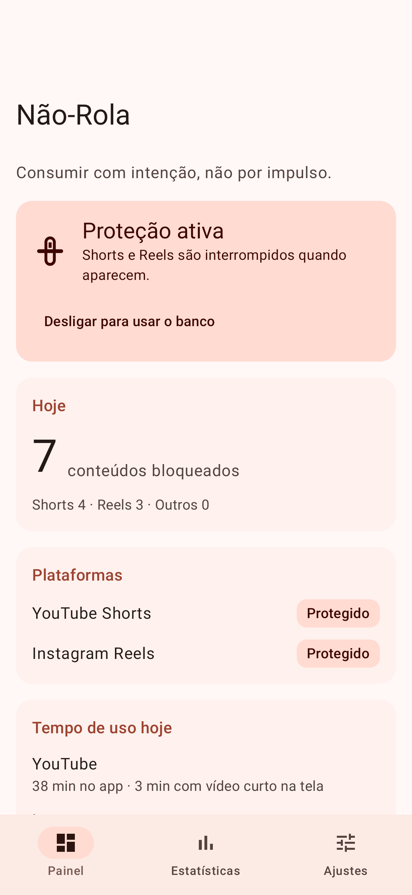 | 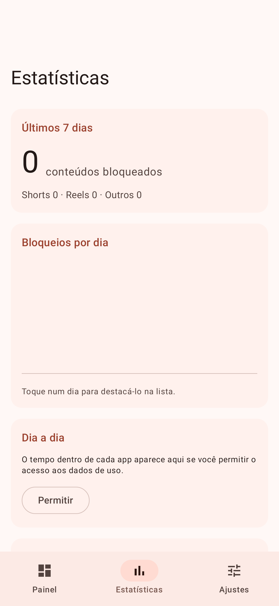 | 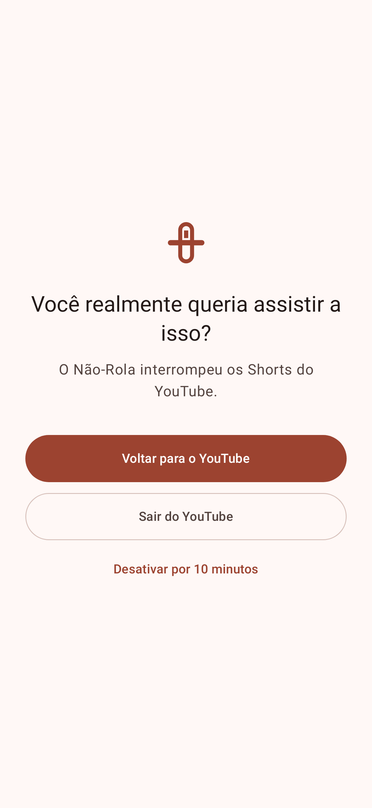 | 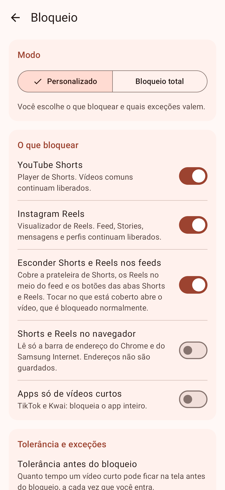 | 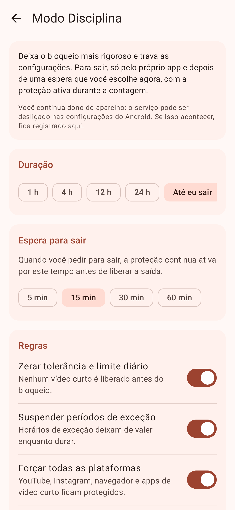 | 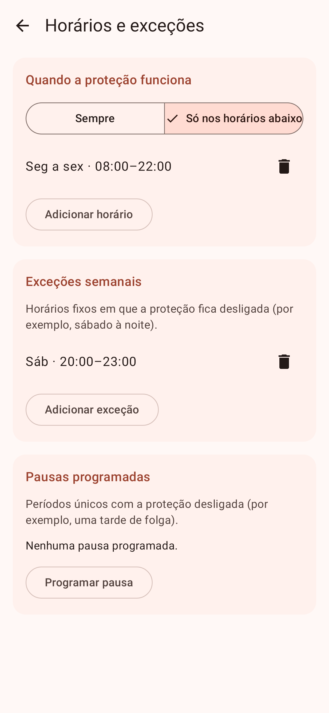 |

| Anúncios | Painel (desligado) | Aviso de detecção | Permissões | Ajustes | Escuro | Bloqueio (escuro) |
|---|---|---|---|---|---|---|
| 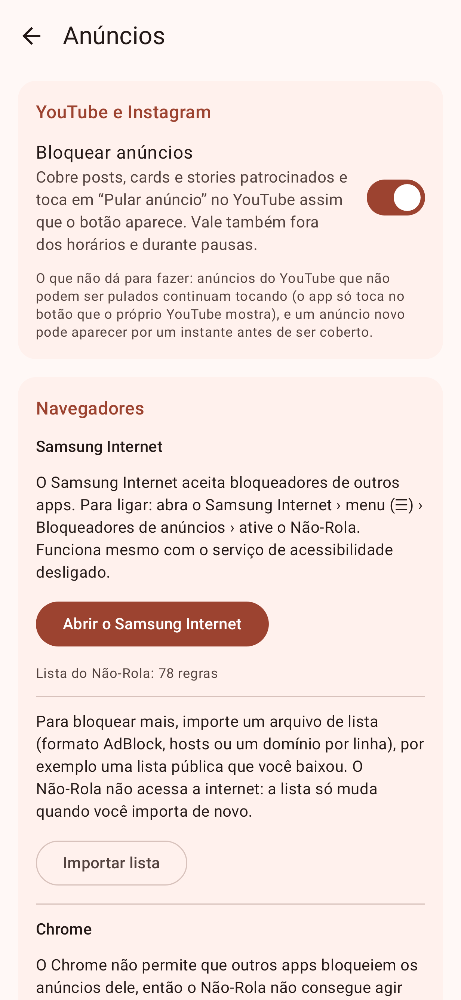 | 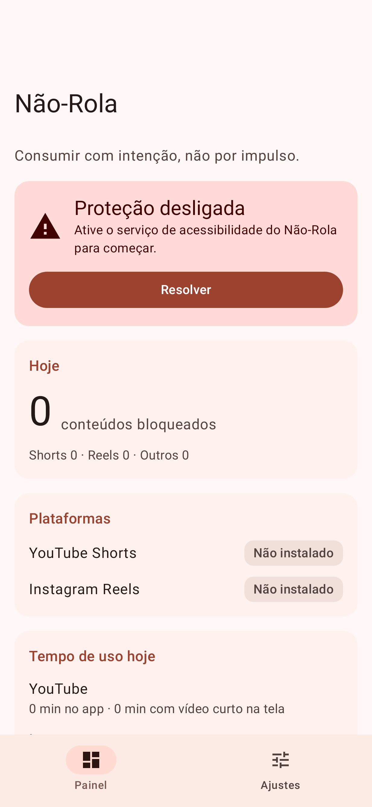 | 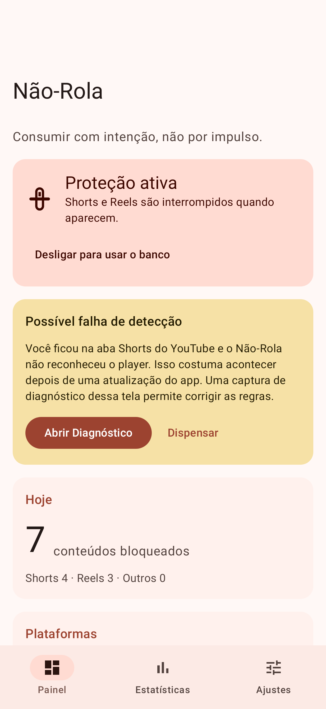 | 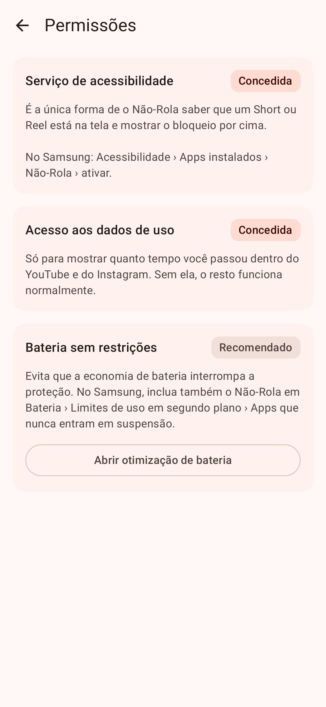 | 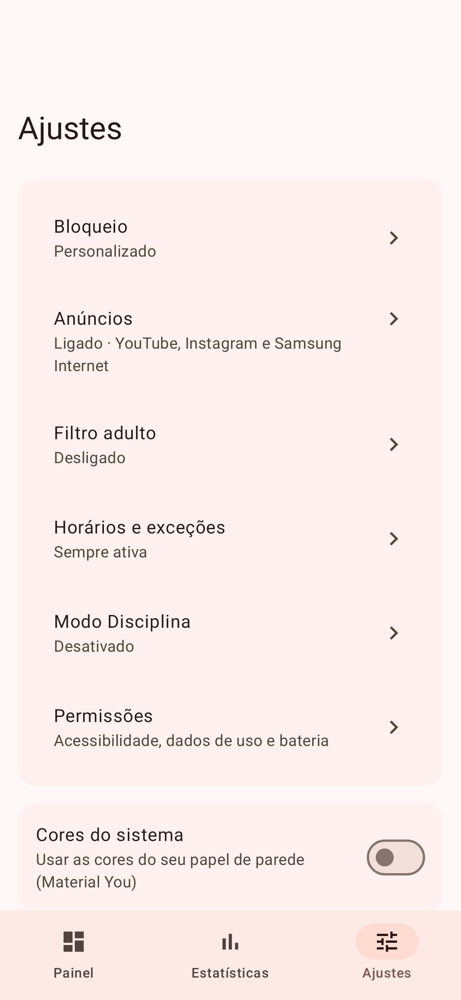 | 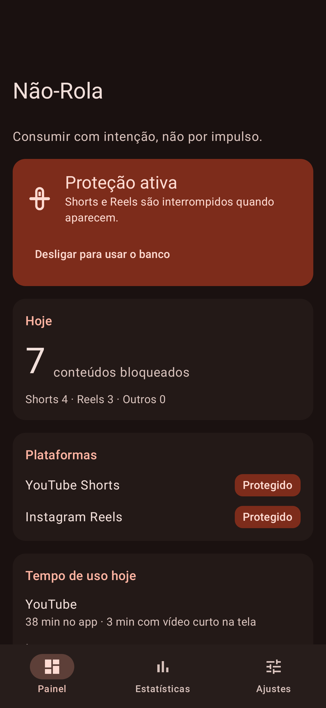 | 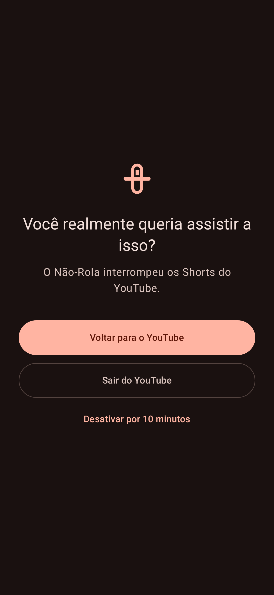 |

---

## Instalação no Galaxy S26

Desde 30/09/2026, no Brasil, o Android exige que APKs instalados fora de lojas venham de desenvolvedores registrados no Google. **A instalação por `adb` não é afetada**, por isso é o caminho recomendado.

### Opção A: pelo computador, com `adb` (recomendada)

1. No celular: *Configurações › Sobre o telefone › Informações de software*, toque 7 vezes em **Número de compilação** para liberar as Opções do desenvolvedor.
2. *Configurações › Opções do desenvolvedor* › ative **Depuração USB**.
3. Se o **Auto Blocker** estiver ativo (*Configurações › Segurança e privacidade › Auto Blocker*), desative-o temporariamente. Ele bloqueia comandos via cabo USB.
4. Conecte o cabo, aceite a autorização no celular e rode:

```bash
adb install -r release/NaoRola-0.4.0.apk
```

### Opção B: pelo arquivo

Copie o APK para o celular e abra no **Meus Arquivos**. Dependendo da liberação da verificação de desenvolvedor no seu aparelho, o Android pode exigir o *fluxo avançado* (uma espera única de 24 h) ou recusar a instalação. O Auto Blocker também precisa estar desligado.

### Atualizações

Versões futuras precisam ser assinadas com a **mesma chave** para instalar por cima e manter configurações e histórico. A chave não fica no repositório (veja [Assinatura](#assinatura)).

---

## O que dá para configurar

| Onde | O quê |
|---|---|
| *Ajustes › Bloqueio* | Modo **Personalizado** ou **Bloqueio total**. Plataformas (YouTube Shorts, Instagram Reels, navegador, apps só de vídeo curto). **Esconder Shorts e Reels nos feeds** (ligado por padrão). Tolerância por entrada (nenhuma, 5 s a 60 s ou sem limite). **Limite diário** somado por plataforma. Pausa temporária e sua duração. Reel recebido por DM liberado. |
| *Ajustes › Anúncios* | Capas sobre anúncios e "Pular anúncio" no YouTube/Instagram (vale também fora dos horários e durante pausas). Bloqueador do Samsung Internet: lista própria e importação de uma lista maior (AdBlock, hosts ou um domínio por linha). Explicação sobre o Chrome. |
| *Ajustes › Horários e exceções* | Proteção sempre ativa ou só em horários semanais, exceções semanais (proteção desligada) e pausas programadas. |
| *Ajustes › Modo Disciplina* | Duração (1 h a 24 h ou até sair pelo app), espera para sair (5 a 60 min) e regras: zerar tolerância e limite, suspender exceções, forçar todas as plataformas, manter Reel de DM, forçar Bloqueio total. Configurações ficam travadas; a pausa some da tela de bloqueio. |

**Como tolerância e limite diário se combinam:** a cada entrada, o vídeo curto pode ficar na tela pelo menor entre a tolerância e o que resta do limite do dia. Sem tolerância nem limite, o bloqueio é imediato. Para "10 minutos por dia, como quiser", use tolerância **Sem limite** + limite diário **10 min**.

## Primeiro uso: permissões

O app mostra cada permissão, explica para que serve e abre a tela certa do Android (*Ajustes › Permissões*).

| Permissão | Obrigatória? | Por quê |
|---|---|---|
| **Serviço de acessibilidade** | Sim | É a única forma de saber que um Short ou Reel está na tela e mostrar o bloqueio. O app só observa os apps cuja proteção está ligada. |
| Acesso aos dados de uso | Não | Só para mostrar o tempo total dentro do YouTube e do Instagram. |
| Bateria sem restrições | Recomendado | Evita que a economia de bateria interrompa o serviço. |

Passo a passo no S26:

1. Abra o Não-Rola e toque em **Resolver** (ou *Ajustes › Permissões*).
2. Leia o aviso e toque em **Entendi, abrir configurações**. Vá em *Acessibilidade › Apps instalados › Não-Rola* e ative.
3. **Se aparecer "configuração restrita"** (comum em APK instalado por arquivo): volte, abra *Configurações › Apps › Não-Rola*, toque em **⋮ › Permitir configurações restritas** e ative de novo.
4. Opcional: em *Permissões › Acesso aos dados de uso*, ative o Não-Rola.
5. Recomendado: em *Configurações › Bateria › Limites de uso em segundo plano › Apps que nunca entram em suspensão*, adicione o Não-Rola.

**Proteção Avançada (Android 17 / One UI 9):** com ela ligada, o Android só permite serviços de ferramentas de acessibilidade. O Não-Rola não é uma e não se declara como tal, então não funciona nesse modo. O app detecta e avisa.

É esperado que o Android lembre de tempos em tempos que o app "pode ver e controlar a tela".

## Apps de banco (Nubank)

Apps de banco como o Nubank consultam o Android (Play Integrity) e recusam funcionar quando há um **serviço de acessibilidade ligado de um app que não veio da Play Store**. É uma defesa contra golpes que usam acessibilidade para controlar o celular. O Não-Rola não tenta se esconder nem contornar essa checagem: o caminho honesto é desligar o serviço enquanto usa o banco.

- No Painel, toque em **Desligar para usar o banco**. O serviço é desligado de verdade (como nas configurações do Android).
- Ou adicione o bloco **Não-Rola** às Configurações rápidas (puxe a cortina › lápis › arraste o bloco). Um toque desliga; com ele desligado, o toque abre a tela de acessibilidade para religar.
- Para religar: **Religar proteção** no Painel, ou pelo bloco.

Se o Nubank continuar recusando com o serviço desligado, a checagem é outra (apps instalados fora da loja) e só a distribuição pela Play Store resolveria. Durante o Modo Disciplina, cada desligamento é contado e aparece na tela da Disciplina.

## Anúncios

| Onde | O que o Não-Rola faz | O que não dá |
|---|---|---|
| YouTube (app) | Cobre cards "Patrocinado" no feed e toca em **Pular anúncio** assim que o botão aparece | Anúncio que não pode ser pulado continua tocando |
| Instagram (app) | Cobre posts patrocinados (cabeçalho, mídia e botões) e stories patrocinados (toque para passar) | Um anúncio novo pode aparecer por um instante antes de ser coberto |
| Samsung Internet | Bloqueia domínios de anúncios pela interface oficial de bloqueadores. Ative em *Samsung Internet › menu (☰) › Bloqueadores de anúncios › Não-Rola* | Vídeos de anúncio dentro do YouTube no navegador vêm do mesmo servidor dos vídeos e podem passar |
| Chrome | Nada: o Chrome não oferece interface para bloqueadores de outros apps | Alternativa do Android, para o celular todo: *DNS privado* com um provedor que filtra anúncios (escolha sua) |

A lista do Samsung Internet funciona mesmo com o serviço de acessibilidade desligado. Para bloquear mais, importe uma lista pública baixada por você (*Ajustes › Anúncios › Importar lista*); o app não tem permissão de internet e não baixa nada sozinho.

---

## Calibração

Esta é a etapa que transforma regras candidatas em regras confirmadas.

1. Em *Ajustes › Diagnóstico*, toque em **Capturar próxima tela**.
2. Abra a tela que quer registrar. O app salva **só a estrutura** (tipos de elemento, identificadores, posições relativas), sem nenhum texto, nome, mensagem ou endereço.
3. Na lista de capturas, marque **Deveria bloquear** ou **Não deveria bloquear**.
4. Toque em **Compartilhar** e coloque o arquivo em [`docs/capturas/`](docs/capturas/README.md) (de preferência numa branch ou pull request).

Toda captura marcada nessa pasta vira um **teste automático** (`CapturedScreensTest`): o CI mostra na hora quais telas reais o detector erra, com os sinais que viu. Cada correção de regra fica verificada contra a tela que a motivou.

Capturas que mais ajudam:

| # | Tela |
|---|---|
| 1 | YouTube: aba Shorts |
| 2 | YouTube: Short aberto a partir do Início |
| 3 | YouTube: vídeo comum (inclusive um vertical) |
| 4 | Instagram: aba Reels |
| 5 | Instagram: Reel aberto a partir do feed |
| 6 | Instagram: Reel aberto numa conversa (DM) |
| 7 | Instagram: Stories |
| 8 | Instagram: feed com um Reel visível |
| 9 | Chrome e Samsung Internet com `youtube.com/shorts/…` |
| 10 | YouTube: Início com a prateleira de Shorts visível (marcar **Não deveria bloquear**) |
| 11 | YouTube: vídeo com anúncio e o botão "Pular" visível |
| 12 | YouTube: card "Patrocinado" no Início |
| 13 | Instagram: post patrocinado no feed e story patrocinado |

Cada captura também registra a conclusão do detector, as **regiões** que seriam cobertas e as **ações** (como "pular anúncio"), para mostrar o que foi ou não reconhecido. Rótulos de anúncio são gravados como "patrocinado", sem o nome do anunciante. Os arquivos viram testes automáticos: o mesmo formato é lido pelos testes do `:engine`.

**Aviso automático.** Se você ficar na aba Shorts ou Reels por alguns segundos e o player não for reconhecido, o Painel mostra **"Possível falha de detecção"**. Isso costuma indicar que uma atualização do YouTube ou do Instagram mudou a tela. Toque em *Abrir Diagnóstico*, depois em *Capturar próxima tela*, e volte à aba: essa é exatamente a captura que permite corrigir as regras. O aviso some sozinho quando a detecção volta a funcionar.

---

## Como funciona

```
eventos de acessibilidade ─► limitador ─► leitura da tela (thread única)
   ─► detector do app (YouTube / Instagram / navegador / pacote)
   ─► classificador (sinais com peso, veto por sinal negativo, limiar)
   ─► máquina de sessão (tolerância, Reel de DM, pausa, Bloqueio total, Disciplina)
   ─► comandos: tela de bloqueio · voltar · início · registrar estatística
   └► fora do player: regiões (prateleira de Shorts, Reels no feed, abas, anúncios)
        ─► política de capas ─► janela de capas que não recebe toques
      e ações ─► tocar em "Pular anúncio"
```

- **Dois módulos.** `:engine` é Kotlin puro (detecção, política, sessão, estatísticas), testado na JVM sem Android. `:app` é a camada Android (serviço, overlay, dados, telas).
- **Sinais múltiplos.** Identificadores do player, formato de "pager vertical em tela cheia", aba selecionada e sinais negativos (player convencional, Stories). Na dúvida, não bloqueia.
- **Armadilha conhecida:** no Instagram, "reel" é o nome interno dos **Stories** e "clips" é o dos **Reels**. No YouTube, "reel" significa **Shorts**. Por isso cada app tem suas próprias regras.
- **Tela de bloqueio** como overlay de acessibilidade, sem a permissão "sobrepor a outros apps". "Voltar" sai do player; "Sair" vai para a tela inicial. Nenhum app consegue fechar outro.
- **Capas** numa janela de acessibilidade que não recebe toques: o app de baixo continua funcionando; tocar num Short coberto abre o player, que é bloqueado normalmente. A prateleira de Shorts é reconhecida pelo formato (miniaturas em pé lado a lado), não só por identificadores. Entre leituras da tela, as capas acompanham a rolagem pelo deslocamento informado pelo próprio Android; ao sair do app ou abrir a cortina de notificações, elas somem.

Detalhes em [docs/FASE-1-VIABILIDADE.md](docs/FASE-1-VIABILIDADE.md) e [docs/FASE-2-ARQUITETURA.md](docs/FASE-2-ARQUITETURA.md).

## Privacidade

- **Sem permissão de internet**: o app não tem como enviar dados.
- O Samsung Internet lê do Não-Rola apenas a lista de filtros (domínios de anúncios e o que você importou). O app não recebe nada do navegador.
- O serviço só recebe eventos dos apps cuja proteção está ligada. Textos, mensagens, nomes e URLs são lidos só quando necessário, em memória, e **nunca** são guardados ou registrados em log.
- Histórico local: horário e tipo de cada bloqueio, por 30 dias. Backup em nuvem e transferência entre aparelhos estão desativados.
- Capturas de diagnóstico e log ficam no armazenamento privado do app até você decidir compartilhar ou apagar.

---

## Compilação

Requisitos: JDK 17+ e Android SDK com a plataforma 37. O Gradle 9.9 é baixado pelo wrapper.

```bash
./gradlew :engine:test :app:testDebugUnitTest
```

```bash
./gradlew :app:assembleRelease
```

```bash
./gradlew :app:testDebugUnitTest --tests "*ScreenshotTest*" -Pscreenshots
```

O último comando gera as capturas de tela em `app/build/screenshots/`.

### Assinatura

O build release lê `keystore.properties` na raiz (fora do Git):

```properties
storeFile=keystore/naorola-release.jks
storePassword=...
keyAlias=naorola
keyPassword=...
```

Sem esse arquivo, o release é assinado com a chave de debug. Os APKs 0.1.0 a 0.4.0 foram assinados com a mesma chave de release, gerada no ambiente de build e entregue fora do Git. Para publicar atualizações por cima deles, é preciso usar essa chave.

## Testes

190 testes automatizados (136 no `:engine`, 54 no `:app`), mais 8 de captura de tela. Testes e lint também rodam no GitHub Actions a cada pull request e a cada push na `main` (`.github/workflows/ci.yml`).

| Suíte | Cobre |
|---|---|
| `YouTubeContentDetectorTest` | Shorts pela aba e pela Início, ids renomeados, mini player, vídeo comum (inclusive tela cheia), prateleira de Shorts não bloqueada |
| `InstagramContentDetectorTest` | Aba Reels, Reel do feed e da DM, ids renomeados, **Stories nunca bloqueados**, feed e DM reconhecidos, troca de página |
| `BrowserContentDetectorTest` | URLs de Shorts/Reels, URLs legítimas e enganosas, barra de endereço por id e por posição |
| `CapturedScreensTest` | Toda captura real rotulada em `docs/capturas/` é classificada como o rótulo diz (vazio até a calibração) |
| `DetectionHealthMonitorTest` | Aviso de falha de detecção: só após alguns segundos na aba sem player, nunca por Stories ou vídeo comum, some quando a detecção volta; inclui o detector real numa tela de Shorts "quebrada" |
| `YouTubeRegionFinderTest` | Prateleira de Shorts só pelo formato, grade de Shorts, card "Patrocinado" (e vídeo chamado "Anúncio…" que não é anúncio), aba Shorts, pager de abas que não vira "feed", "Pular anúncio" por id, por rótulo e "Pular" só com anúncio na tela |
| `InstagramRegionFinderTest` | Reel no feed, carrossel de Reels, post patrocinado inteiro, story patrocinado, cartões em pé que não são Reels, Reel enviado em conversa continua visível |
| `AdRulesTest`, `CoverPolicyTest`, `FilterListTest` | Rótulos de anúncio, quando cada capa aparece (chaves, pausa, Bloqueio total, Disciplina), listas AdBlock/hosts/domínios |
| `ShortVideoClassifierTest`, `TreeScannerTest`, `StructureDumpTest` | Limiar, veto, limite de nós, itens de feed e cartões em pé, privacidade do resumo e do diagnóstico, ida e volta do formato (inclusive regiões, sem o nome do anunciante) |
| `BlockingPolicyTest`, `DisciplineTest`, `ScheduleAndCodecTest` | Bloqueio total, limite diário, regras configuráveis da Disciplina, trava das configurações, horários (inclusive após a meia-noite) |
| `StatsAndTrackerTest` | Uso do dia por plataforma (virada da meia-noite), série de 7 dias, estimativa só com dados suficientes |
| `BlockingSessionMachineTest` | Tolerância, voltar com nova tentativa, sair, pausa, Reel de DM (inclusive com tela de carregamento no meio), troca de app, tela desligada, tempo exposto |
| `ForegroundTimeCalculatorTest` | Tempo dentro de cada app a partir de eventos de uso |
| `SettingsRepositoryTest`, `StatsRepositoryTest`, `DailyUsageHistoryTest` | Persistência real (DataStore, Room), trava da Disciplina, contagens do dia, retenção, uso por dia (dia sem dados nunca vira zero) |
| `DatabaseMigrationTest` | Atualização do banco da 0.1.0 (v1 → v2) sem perder histórico |
| `BlockScreenTest`, `BlockingOverlayManagerTest` | Botões da tela de bloqueio e janela do overlay |
| `RegionCoverOverlayTest` | Uma janela para todas as capas, sem receber toques; capas seguem a rolagem; resultado atrasado realinhado; janela removida quando não há capas |
| `BrowserFiltersTest`, `AdsScreenTest` | Lista entregue ao Samsung Internet, importação de arquivo hosts mesclada e aviso de recarga, tela de Anúncios e abertura direta pelo Samsung Internet |
| `BankingToggleTest` | Desligar para usar o banco (Painel e bloco de Configurações rápidas) e religar |
| `ServiceLifecycleTest` | Serviço ligado/desligado pelo usuário refletido no app |
| `AppSmokeTest`, `DisciplineFlowTest`, `ScheduleFlowTest` | Passeio por todas as telas gravando alterações; ativar a Disciplina trava as configurações e inicia a espera para sair; criar horário e exceção |
| `ScheduleFormatTest` | Janelas (meia-noite, dias) e rótulos |
| `SuspicionCardTest` | Aviso de detecção no Painel: abre o Diagnóstico e pode ser dispensado |
| `DiagnosticRecorderTest` | Uma captura por pedido, rótulo gravado no arquivo sem reordenar a lista, nada fora da pasta de capturas |

Roteiro no aparelho: [docs/TESTES-MANUAIS.md](docs/TESTES-MANUAIS.md).

## Estrutura

```
engine/   Kotlin puro: core · domain (modelos, política, sessão, estatísticas) · detection (árvore, regras, detectores, classificador, diagnóstico)
app/      Android: accessibility · blocking · monitoring · data (DataStore, Room, log) · presentation (Compose) · di · core
docs/     Fase 1 (viabilidade), Fase 2 (arquitetura), testes manuais, capturas
release/  APK instalável
```

## Limitações conhecidas

- As regras de detecção **ainda não foram calibradas** em aparelho; algumas telas podem não ser reconhecidas.
- Atualizações do YouTube e do Instagram podem quebrar a detecção até sair uma versão nova. Sem servidor, não há atualização remota de regras.
- O vídeo pode continuar tocando sob a tela de bloqueio até você tocar em Voltar (o pedido de foco de áudio é só uma tentativa).
- As capas de feed e de anúncios ainda não foram calibradas em aparelho: algumas prateleiras, Reels ou anúncios podem passar. Ao rolar rápido, um item novo pode aparecer por um instante antes de ser coberto.
- Anúncios do YouTube que não podem ser pulados continuam tocando. O Chrome não aceita bloqueadores de outros apps.
- Apps de banco podem recusar funcionar com o serviço ligado; use o desligamento rápido (veja [Apps de banco](#apps-de-banco-nubank)).
- A estimativa de exposição evitada é conservadora e só aparece com pelo menos 10 sessões de vídeo curto medidas.
- O tempo dentro dos apps depende do acesso aos dados de uso e do que o Android ainda guarda: dias antigos sem registro aparecem como "sem dados".
- O Android pode encerrar o serviço por falha, atualização ou economia de bateria; o Painel mostra quando isso acontece.
- Você continua dono do aparelho: o serviço pode ser desativado nas configurações do Android, inclusive durante o Modo Disciplina.
- Interface somente em português.
