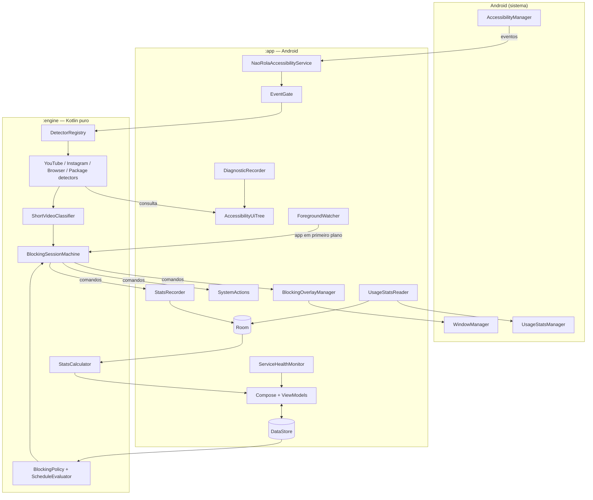
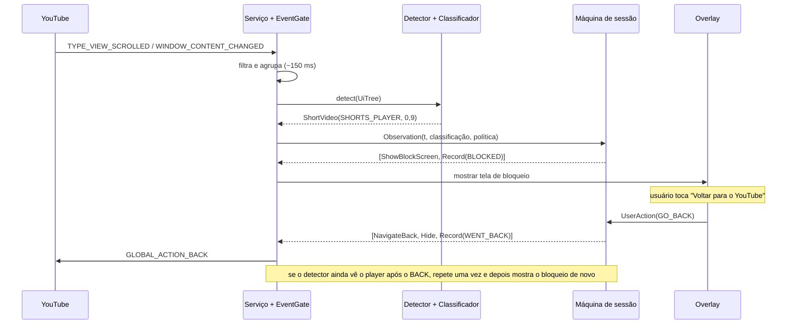
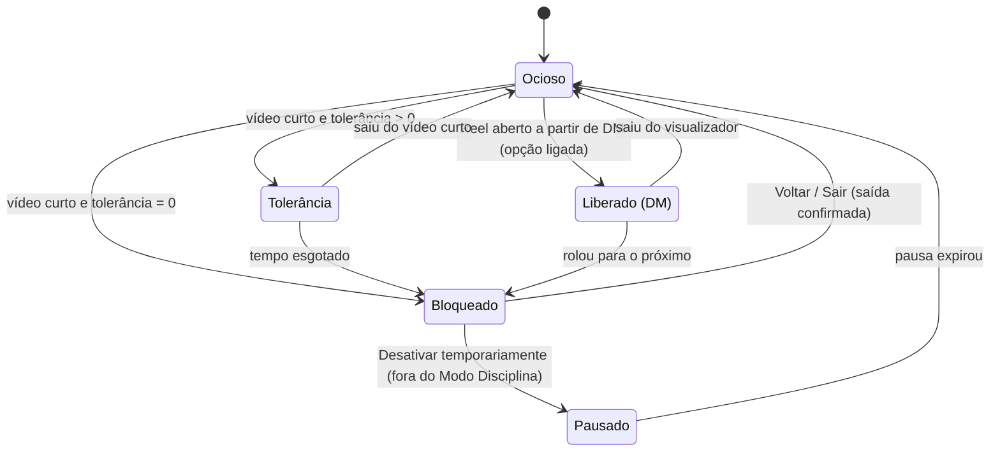

# Não-Rola — Fase 2: Arquitetura

> Base: [Fase 1 — Viabilidade](FASE-1-VIABILIDADE.md) e as respostas registradas na seção 1 abaixo. Ainda sem código: este documento define **o que** será construído e **como** as peças se encaixam.

---

## 1. Decisões que mudaram desde a Fase 1

| Pergunta | Sua resposta | Consequência na arquitetura |
|---|---|---|
| Reels no meio do feed principal do Instagram | **Bloquear** | Novo tipo de bloqueio: **cobertura de região** (seção 6.2). É a parte menos confiável do projeto e será marcada como **experimental** e desligável |
| Reel recebido por DM | **Liberar o aberto, bloquear o próximo — configurável** | A máquina de sessão guarda o **contexto de origem** (DM) e reage à rolagem (seção 6.3) |
| Shorts no navegador | **Bloquear** | Novo `BrowserContentDetector` para Chrome e Samsung Internet. Proponho incluir também `instagram.com/reel(s)/`, que tem custo quase zero |
| Aparelho | **Ainda não disponível** | A calibração com dados reais fica para quando houver um Android em mãos (seção 11) |

---

## 2. Visão geral

**Princípio central:** toda a inteligência (detecção, classificação, política de bloqueio, regras de tempo, estatísticas) fica em **Kotlin puro, sem Android**. A camada Android só traduz: eventos do sistema viram dados de entrada, e comandos viram ações na tela.

Por que isso importa aqui:

1. **Testabilidade.** Não há como rodar YouTube e Instagram em testes automatizados. Se os detectores recebem uma árvore abstrata (e não `AccessibilityNodeInfo`), dá para testá-los com árvores sintéticas e com **árvores gravadas pelo modo diagnóstico no seu aparelho**.
2. **Manutenção.** Quando o YouTube mudar a interface, a correção fica em um arquivo de regras e em um teste, sem mexer no serviço Android.
3. **Fronteiras garantidas pelo compilador.** Um módulo Gradle sem dependência do Android não *consegue* importar classes do Android por engano.

### Módulos Gradle

| Módulo | Tipo | Conteúdo |
|---|---|---|
| `:engine` | Kotlin/JVM puro | `core`, `domain`, `detection`: modelos, detectores, classificador, política, máquina de sessão, cálculos de estatística |
| `:app` | Aplicação Android | `accessibility`, `blocking`, `monitoring`, `data`, `presentation`, `di`, `core` (utilidades Android) |

Dois módulos, não mais: separar `data`, `presentation` etc. em módulos próprios só aumentaria configuração e tempo de build num app deste tamanho. Dentro do `:app`, as fronteiras são por pacote.

---

## 3. Estrutura de diretórios

```
nao-rola-apk/
├── settings.gradle.kts · build.gradle.kts · gradle/libs.versions.toml
├── docs/                                  FASE-1, FASE-2, (depois) TESTES-MANUAIS, PERMISSOES…
│
├── engine/                                ── Kotlin puro (sem Android) ──
│   └── src/
│       ├── main/kotlin/com/lucasanso/naorola/
│       │   ├── core/                      Clock, AppLogger (interface), constantes de tempo
│       │   ├── domain/
│       │   │   ├── model/                 Platform, Surface, ScreenContext, ProtectionSettings,
│       │   │   │                          ScheduleWindow, ExceptionPeriod, DisciplineState, BlockEvent…
│       │   │   ├── policy/                BlockingPolicy, ScheduleEvaluator, SettingsCodec
│       │   │   ├── session/               BlockingSessionMachine, Observation, Command, UserAction
│       │   │   └── stats/                 ForegroundTimeCalculator, StatsCalculator, AvoidedExposureEstimator
│       │   └── detection/
│       │       ├── tree/                  UiNode, UiTree, RelBounds, TreeQueries (busca limitada)
│       │       ├── signal/                Signal, SignalPolarity, DetectionResult
│       │       ├── rules/                 YouTubeRules, InstagramRules, BrowserRules, ShortVideoApps
│       │       ├── detector/              ContentDetector (interface), DetectorRegistry,
│       │       │                          YouTubeContentDetector, InstagramContentDetector,
│       │       │                          BrowserContentDetector, PackageContentDetector
│       │       ├── classifier/            ShortVideoClassifier, Classification
│       │       └── diagnostics/           StructureDumpFormat (gravar/ler árvores)
│       └── test/
│           ├── kotlin/…                   testes de detectores, classificador, política, sessão, estatísticas
│           └── resources/fixtures/        árvores sintéticas e (depois) gravadas no aparelho
│
└── app/                                   ── Android ──
    └── src/
        ├── main/
        │   ├── AndroidManifest.xml
        │   ├── res/xml/accessibility_service_config.xml
        │   └── java/com/lucasanso/naorola/
        │       ├── NaoRolaApp.kt · MainActivity.kt
        │       ├── di/                    AppContainer (injeção manual)
        │       ├── accessibility/         NaoRolaAccessibilityService, EventGate,
        │       │                          AccessibilityUiTree (adaptador), ForegroundWatcher,
        │       │                          ServiceInfoUpdater, ServiceStatus
        │       ├── blocking/              BlockingOverlayManager, BlockScreenView,
        │       │                          RegionCoverOverlay, SystemActions, AudioFocusMuter
        │       ├── monitoring/            UsageStatsReader, DailyUsageSync, ServiceHealthMonitor,
        │       │                          DiagnosticRecorder
        │       ├── data/
        │       │   ├── settings/          SettingsRepository (DataStore)
        │       │   ├── db/                NaoRolaDatabase, entidades, DAOs (Room)
        │       │   ├── stats/             StatsRepository, StatsRecorder
        │       │   └── log/               LocalLogStore (arquivo rotativo local)
        │       ├── presentation/
        │       │   ├── theme/ · navigation/ · components/
        │       │   ├── dashboard/ · settings/ · stats/ · discipline/
        │       │   ├── permissions/ · about/ · diagnostics/
        │       └── core/                  AndroidClock, SettingsIntents, PermissionChecks
        └── test/                          Robolectric: Room, DataStore, overlay, serviço, UI
```

**Pacote e ID do app:** `com.lucasanso.naorola`, seguindo o padrão que você já usa no TaskFlow (`com.lucasanso.taskflow`).

---

## 4. Responsabilidade de cada parte

### `:engine`

| Pacote / classe | Responsabilidade | Não faz |
|---|---|---|
| `detection/tree` — `UiNode`, `UiTree` | Abstração da tela: classe, ID de recurso, limites **relativos à tela** (0–1), rolável, selecionado, se tem texto ou descrição, filhos. `UiTree.findByViewId()` permite usar o caminho rápido do Android | Não conhece `AccessibilityNodeInfo` |
| `detection/rules` | **Regras como dados**: IDs conhecidos, pesos, limiares, padrões de URL, pacotes de apps de vídeo curto. Cada conjunto tem `version` e `validatedOn` (versão do app em que foi conferido) | Sem lógica |
| `ContentDetector` (interface) | `supports(packageName)` e `detect(tree, event) → DetectionResult` (sinais + contexto da tela + regiões) | Não decide bloquear |
| `YouTubeContentDetector` | Sinais do player de Shorts (IDs `reel_*`, pager vertical em tela cheia, aba Shorts) e negativos (player convencional) | — |
| `InstagramContentDetector` | Sinais do visualizador de Reels (`clips_*`), itens de Reel no feed (regiões), contexto (DM, Stories, feed, perfil, Explorar). Regra negativa explícita para Stories (`reel_viewer_*`) | — |
| `BrowserContentDetector` | Lê o texto da barra de endereço (Chrome, Samsung Internet), interpreta host e caminho **em memória** e devolve só o resultado: é ou não `/shorts/`, `/reel/`, `/reels/` | Não guarda nem registra URLs |
| `PackageContentDetector` | "Outros formatos": apps que são inteiramente de vídeo curto (TikTok, Kwai…), identificados pelo pacote | — |
| `DetectorRegistry` | Escolhe o detector pelo pacote. Novo app = nova classe + registro, sem mexer nas outras | — |
| `ShortVideoClassifier` | Agrega sinais (soma ponderada, veto por sinal negativo forte, limiar) → `Classification` (`None` ou `ShortVideo(platform, surface, confidence, regions, context)`) | Não conhece apps específicos |
| `BlockingPolicy` + `ScheduleEvaluator` | Dadas as configurações e a hora: a proteção está ativa para esta plataforma? Qual a tolerância? A pausa é permitida? A exceção de DM vale? | — |
| `BlockingSessionMachine` | Máquina de estados (seção 6). Entrada: observações com horário e ações do usuário. Saída: **lista de comandos** (`ShowBlockScreen`, `CoverRegions`, `NavigateBack`, `Record(...)`…) | Não executa nada: só decide |
| `stats/*` | Tempo em primeiro plano a partir de eventos de uso, agregados diários, estimativa de exposição evitada (só com base mínima de dados) | — |
| `SettingsCodec` | Codifica e decodifica listas (horários, exceções) em texto versionado para o DataStore | — |

### `:app`

| Pacote / classe | Responsabilidade |
|---|---|
| `NaoRolaAccessibilityService` | Ponto de entrada do sistema. Recebe eventos, entrega ao pipeline, executa comandos. **Nenhuma exceção sai dele** (uma falha faria o Android marcar o serviço como "não está funcionando") |
| `EventGate` | Filtra (pacotes, tipos, ignora o próprio app), copia os campos necessários do evento e agrupa rajadas (~150 ms, sempre o mais recente) |
| `AccessibilityUiTree` | Adaptador `AccessibilityNodeInfo` → `UiTree`, **preguiçoso** (só lê o que o detector pede) e com limite de nós visitados |
| `ForegroundWatcher` | Enquanto há sessão ativa (tolerância, bloqueio, Reel de DM liberado), verifica periodicamente qual app está em primeiro plano via `getWindows()`. Motivo: o serviço só recebe eventos dos apps-alvo, então **não fica sabendo** quando o usuário vai para outro app (seção 7) |
| `ServiceInfoUpdater` | Ajusta `packageNames` do serviço em tempo de execução: se o bloqueio do navegador está desligado, o serviço **nem recebe** eventos do navegador |
| `BlockingOverlayManager` | Mostra e esconde a tela de bloqueio (`TYPE_ACCESSIBILITY_OVERLAY`, tela cheia, consome toques) e as coberturas de região. Única classe que fala com o `WindowManager` |
| `BlockScreenView` | A tela "Você realmente queria assistir a isso?" com os botões. Só emite ações; não decide nada |
| `RegionCoverOverlay` | Cobertura opaca sobre itens de Reel no feed, sem consumir toques (a rolagem continua funcionando) |
| `SystemActions` | `GLOBAL_ACTION_BACK` / `GLOBAL_ACTION_HOME` |
| `AudioFocusMuter` | Pede foco de áudio transitório durante o bloqueio, como tentativa de silenciar. Efeito validado no aparelho |
| `UsageStatsReader` + `DailyUsageSync` | Lê eventos de uso do dia e grava agregados diários no Room (o Android guarda os eventos detalhados por pouco tempo) |
| `ServiceHealthMonitor` | Estado real da proteção: serviço habilitado? conectado? Proteção Avançada ligada? acesso aos dados de uso? otimização de bateria? |
| `DiagnosticRecorder` | Modo diagnóstico: grava **só a estrutura** da tela (sem textos, descrições ou URLs) e permite compartilhar o arquivo pela folha de compartilhamento do Android |
| `SettingsRepository` | DataStore Preferences → `Flow<ProtectionSettings>` |
| `StatsRepository` / `StatsRecorder` | Room: grava eventos de bloqueio, sessões de vídeo curto e eventos da proteção; fornece séries para as telas |
| `LocalLogStore` | Log técnico local (arquivo rotativo, ~256 KB): detector, classificação, confiança, erros. **Nunca** conteúdo da tela |
| `AppContainer` | Injeção de dependência manual: cria as instâncias únicas (DataStore, Room, repositórios) e as entrega ao serviço e aos ViewModels |
| `presentation/*` | Compose + ViewModels com `StateFlow<UiState>`. As telas só exibem estado e emitem intenções |

---

## 5. Diagrama de componentes



**Dependências apontam para dentro:** `:app` depende de `:engine`; `:engine` não depende de nada do Android. Detectores não conhecem o serviço; o serviço só conhece a interface `ContentDetector`, via `DetectorRegistry`.

---

## 6. Fluxos

### 6.1 Identificação e bloqueio (player de Shorts / visualizador de Reels / navegador)



### 6.2 Reels no feed do Instagram (experimental)

1. O `InstagramContentDetector` identifica itens de Reel visíveis no feed e o carrossel "Reels sugeridos" (`clips_header_title`, ID já confirmado) e devolve as **regiões** de cada um (frações da tela).
2. A máquina de sessão emite `CoverRegions(regiões)`. O `RegionCoverOverlay` desenha coberturas opacas ("Reel oculto") sobre essas regiões, **sem consumir toques**: a rolagem do feed continua normal.
3. A cada rolagem, as regiões são recalculadas e as coberturas reposicionadas.
4. Tocar num Reel coberto abre o visualizador, que cai no bloqueio de tela cheia (6.1).

**Limitações honestas:**

- As coberturas se movem na cadência dos eventos de acessibilidade, não a cada quadro. Em rolagem rápida, elas **atrasam** e um pedaço do Reel pode aparecer por um instante.
- O vídeo do feed pode continuar tocando, com som, debaixo da cobertura. Não há como pausá-lo sem interagir com o app.
- Não está decidido como reconhecer um item de Reel no feed: depende de dados reais do aparelho. Até lá, essa função não é ativada.
- **Alternativa descartada:** rolar o feed automaticamente para pular os Reels. Isso brigaria com o usuário e seria imprevisível.

### 6.3 Reel aberto a partir de DM (configurável)

1. O detector informa o **contexto** de cada tela (DM, feed, Stories, perfil, Explorar, visualizador).
2. Se o visualizador de Reels abre em até alguns segundos depois de uma tela de **conversa (DM)** e a opção está ligada, a sessão entra em **"Liberado (DM)"**: nenhum bloqueio.
3. Na primeira **rolagem de página** do visualizador (passar para o próximo Reel), a sessão vai para **Bloqueado**.
4. Saiu do visualizador → volta para o estado ocioso.

### 6.4 Máquina de sessão



- **Proteção inativa** (plataforma desligada, fora do horário, período de exceção): a política diz "não bloquear" e a sessão permanece em Ocioso. O tempo de vídeo curto continua sendo medido, se a plataforma estiver habilitada.
- **Tolerância e limite diário** (ambos configuráveis): a tolerância vale **por entrada**; o limite diário **soma** todo o tempo liberado no dia, por plataforma. O que esgotar primeiro bloqueia. O limite diário entra na Fase 4.
- **Tempo em vídeo curto:** medido enquanto a sessão está em Tolerância, Liberado (DM) ou Pausado com vídeo curto na tela. Vira registros `short_video_sessions` no Room.
- **Relógio injetado** (`Clock`): todos os tempos são testáveis sem esperar.

### 6.5 Configurações

Tela → ViewModel → `SettingsRepository.update { … }` (DataStore, gravação atômica) → `Flow<ProtectionSettings>` → o serviço observa e reconfigura (política, `packageNames`) sem reiniciar.

### 6.6 Modo Disciplina (proposta)

| Aspecto | Comportamento |
|---|---|
| Ativar | Pela tela Modo Disciplina: escolher **até quando** (horário ou indefinido), o **tempo de espera para sair** (5, 15, 30 ou 60 min) e as regras abaixo |
| Sempre | Sem "Desativar temporariamente" na tela de bloqueio |
| Regras configuráveis na ativação (padrão entre parênteses) | Zerar tolerância e limite diário (sim) · suspender períodos de exceção (sim) · forçar todas as plataformas ligadas (sim) · manter o Reel de DM liberado (sim, porque é consumo intencional) · forçar o **Bloqueio total** (não) |
| Configurações | Somente leitura, com um aviso visível do porquê |
| Sair | Só pelo app: "Sair do Modo Disciplina" inicia a espera escolhida. A proteção continua ativa durante a contagem e, no fim, é preciso confirmar. Também termina sozinho no horário definido |
| O que **não** faz | Não bloqueia as Configurações do Android, não impede desinstalar e não se declara ferramenta de acessibilidade |
| Transparência | Se o serviço for desligado durante a Disciplina, isso é registrado e mostrado no painel |

### 6.7 Bloqueio total

Modo de proteção (em Ajustes) que ignora as opções individuais e bloqueia **tudo** o que o app sabe detectar:

- todas as plataformas e superfícies, incluindo Reels no feed, navegador e outros formatos à medida que forem implementados;
- sem tolerância, sem limite diário, sem pausa e sem exceção de DM;
- em qualquer horário.

Fora da Disciplina, liga e desliga livremente. Se a Disciplina foi ativada com "forçar Bloqueio total", ele só sai junto com ela.

### 6.8 Estatísticas

- **Room** guarda: `block_events` (horário, plataforma, superfície, desfecho: bloqueado / voltou / saiu / pausou / liberado por DM), `short_video_sessions` (início, fim, plataforma), `daily_app_usage` (dia, pacote, ms em primeiro plano) e `protection_events` (serviço conectado/desconectado/desabilitado, Disciplina ligada/desligada). **Nenhum conteúdo, texto ou URL.** Retenção: 30 dias.
- **Tempo total no app:** `UsageStatsReader` → `ForegroundTimeCalculator`, que pareia eventos de retomada e pausa, inclusive na virada do dia e com o app ainda aberto.
- **Exposição evitada** (Fase 4): bloqueios × duração **mediana** das suas sessões de vídeo curto quando liberadas (tolerância, pausa, DM) nos últimos 30 dias. Só aparece com **pelo menos 10 sessões medidas**, e a fórmula fica visível. Sem isso, a tela mostra "dados insuficientes".

---

## 7. Decisões técnicas importantes

| # | Decisão | Motivo |
|---|---|---|
| A1 | **Árvore preguiçosa e limitada**, com o caminho rápido por ID primeiro | Cada leitura de nó é uma chamada ao processo do YouTube/Instagram. Ler a árvore inteira a cada evento deixaria **o app-alvo** lento, não só o Não-Rola |
| A2 | **Processamento fora da thread principal:** o evento é copiado na thread principal, a avaliação roda num despachante de fila única, sempre com o evento mais recente, e o overlay volta para a thread principal | `onAccessibilityEvent` roda na thread principal e eventos de conteúdo chegam em rajadas durante a reprodução |
| A3 | **`packageNames` restrito e ajustado em tempo de execução** | O serviço só recebe eventos dos apps cuja proteção está ligada. É menos dado visto, menos bateria e uma explicação mais simples na tela de permissões |
| A4 | **`ForegroundWatcher` por consulta periódica** (só durante sessões ativas) | Com `packageNames` restrito, o serviço não recebe eventos do launcher nem de outros apps. Sem isso, a tela de bloqueio poderia ficar por cima da tela inicial. Receber eventos de todos os apps resolveria, mas é pior para a privacidade |
| A5 | **Tela de bloqueio = overlay + `BACK`**; "Sair" = `HOME` | Fase 1, seção 5 |
| A6 | **Toda a configuração no DataStore** (listas codificadas por `SettingsCodec`); **Room só para histórico** | Configuração numa fonte só, com gravação atômica. Proto DataStore exigiria plugin de protobuf sem ganho real |
| A7 | **Regras como código-dado** (objetos Kotlin imutáveis, versionados), não JSON | Sem biblioteca de JSON, com verificação de tipos, testável na JVM. A importação de um arquivo de regras local pode vir depois |
| A8 | **Formato de diagnóstico em texto, uma linha por nó** (`profundidade · classe · id · limites relativos · flags`) | Legível, fácil de comparar entre versões, sem biblioteca, e o mesmo arquivo vira fixture de teste |
| A9 | **Injeção de dependência manual** (`AppContainer`), sem Hilt | São cerca de 15 objetos com um único grafo. O Hilt traria geração de código e build mais lento sem benefício proporcional |
| A10 | **Sem permissão `INTERNET`** | O app fica tecnicamente incapaz de transmitir dados. É a garantia de privacidade mais forte possível |
| A11 | `isAccessibilityTool="false"` e verificação da Proteção Avançada | Fase 1, R4 |
| A12 | **Nenhuma exceção escapa do serviço**: cada etapa usa `runCatching`, registra no log local e segue | Uma falha não tratada derruba o serviço até o usuário reativá-lo manualmente |
| A13 | **Constantes centralizadas** (`DetectionConfig`, `Timeouts`, regras) | Sem valores mágicos espalhados pelo código |

### Configuração prevista do serviço de acessibilidade

```xml
<accessibility-service
    android:accessibilityEventTypes="typeWindowStateChanged|typeWindowContentChanged|typeViewScrolled|typeViewClicked|typeViewSelected"
    android:accessibilityFeedbackType="feedbackGeneric"
    android:accessibilityFlags="flagReportViewIds|flagRetrieveInteractiveWindows"
    android:canRetrieveWindowContent="true"
    android:notificationTimeout="100"
    android:packageNames="com.google.android.youtube,com.instagram.android"
    android:isAccessibilityTool="false"
    android:description="@string/a11y_service_description" />
```

Os navegadores (`com.android.chrome`, `com.sec.android.app.sbrowser`) e os apps de "outros formatos" entram em `packageNames` só quando você liga essas opções.

---

## 8. Permissões e manifesto

| Item | Status | Por quê |
|---|---|---|
| Serviço de acessibilidade (`BIND_ACCESSIBILITY_SERVICE` no `<service>`) | Obrigatório | Ver o que está na tela dos apps-alvo e mostrar o bloqueio |
| `PACKAGE_USAGE_STATS` | Opcional (concedido pelo usuário) | Tempo total no YouTube e no Instagram |
| `QUERY_ADVANCED_PROTECTION_MODE` | Se a API exigir (confirmar na Fase 3) | Detectar a Proteção Avançada e explicar a incompatibilidade |
| `<queries>` só para os pacotes-alvo | — | Saber se YouTube e Instagram estão instalados, sem `QUERY_ALL_PACKAGES` |
| `FileProvider` | — | Compartilhar o arquivo de diagnóstico, por escolha sua |
| `POST_NOTIFICATIONS` | Só na Fase 4, se aprovado | Avisar quando a proteção cair |
| `INTERNET`, `SYSTEM_ALERT_WINDOW`, `QUERY_ALL_PACKAGES`, Administrador do Dispositivo, `NotificationListener`, VPN, captura de tela | **Não usados** | — |

**Divulgação em destaque:** antes de mandar você às configurações de acessibilidade, o app mostra uma tela explicando exatamente o que é lido, o que nunca é guardado e o que nunca sai do aparelho.

---

## 9. Dependências

Versões exatas são fixadas no início da Fase 3, após um build de verificação. Estado atual dos repositórios: AGP 9.5.x estável, plataforma Android 37 (Android 17) disponível.

| Dependência | Necessária? | Justificativa |
|---|---|---|
| Kotlin + Coroutines/Flow | Sim | Pedido no projeto. Base de toda a assincronia |
| Compose (BOM) + Material 3 + `activity-compose` | Sim | Pedido no projeto. Material You com cor dinâmica |
| `lifecycle-viewmodel-compose` / `lifecycle-runtime-compose` | Sim | ViewModels e `collectAsStateWithLifecycle` |
| `navigation-compose` | Sim | 7 telas, pilha de volta e abertura direta da tela de permissões |
| DataStore Preferences | Sim | Pedido no projeto. Configurações |
| Room + KSP | Sim | Pedido no projeto. Histórico e estatísticas |
| `core-ktx` | Sim | Utilidades básicas e `FileProvider` |
| Ícones | Só os usados | Vetores locais em vez de `material-icons-extended` (enorme) |
| **Testes:** JUnit 4, `kotlinx-coroutines-test`, Robolectric, `compose-ui-test`, `room-testing` | Sim (só em teste) | Lógica na JVM. Room, DataStore, overlay, serviço e telas via Robolectric |
| WorkManager | Fase 4, se aprovado | Só para o aviso de "proteção desligada" |
| Hilt, Retrofit, OkHttp, Firebase, analytics, bibliotecas de JSON | **Não** | Seções 7 e 8 |

**SDK:** `compileSdk`/`targetSdk` 37 (Android 17, o sistema do S26 após a One UI 9); `minSdk` 31 (Android 12). Motivo do `minSdk`: menos caminhos de compatibilidade para testar, e o comportamento de overlays e toques é uniforme a partir do 12. Ainda cobre praticamente qualquer Android dos últimos cinco anos.

---

## 10. Telas e navegação

```
Primeiro uso ─► Permissões (com divulgação em destaque) ─► Painel

Barra inferior:  Painel · Estatísticas · Ajustes
Painel ─► cartão de status (abre Permissões quando falta algo)
       └► cartão Modo Disciplina ─► Modo Disciplina
Ajustes ─► Bloqueio (modo Personalizado/Total, plataformas, tolerância, limite diário, pausa, DM,
        │            feed experimental, navegador, outros formatos)
        ├► Horários e exceções
        ├► Modo Disciplina
        ├► Permissões
        └► Sobre ─► Diagnóstico
```

- **Painel:** status geral; YouTube, Instagram e navegador como protegido, desprotegido ou não instalado; bloqueados hoje; tempo de uso hoje, ou "permissão necessária".
- **Identidade visual** (detalhada na Fase 3): ícone próprio, a ideia de uma rolagem interrompida. Cor da marca como base, com cor dinâmica do Material You quando disponível. Tema claro e escuro. Animações curtas, só em transições de estado.

---

## 11. Testes

| Pedido no projeto | Como será testado |
|---|---|
| Identificação de Shorts / Reels | `:engine`: detectores com árvores sintéticas e, depois, gravadas no aparelho |
| Não bloquear vídeos convencionais / Stories | `:engine`: fixtures negativas obrigatórias (player convencional, visualizador de Stories, DM, feed, perfil) |
| Funcionamento do overlay | Robolectric: `BlockingOverlayManager` adiciona e remove a janela, botões geram as ações certas. Visual: teste manual |
| Alteração de configurações / persistência | Robolectric: DataStore e Room de verdade (ida e volta, codec de listas) |
| Modo Disciplina | `:engine`: máquina de sessão e política com relógio falso. ViewModel: telas bloqueadas e espera de saída |
| Serviço de acessibilidade desativado | `ServiceHealthMonitor` e painel com estado "desprotegido"; sessão encerra e overlay some quando o serviço desconecta |
| Reel de DM, tolerância, pausa, horários | `:engine`: sequências de observações com tempo controlado |
| Navegador | `:engine`: interpretação de URLs (hosts, `m.`, `www.`, `/shorts/`, `/reel/`, falsos positivos como `/watch`) |

**Teste manual no aparelho:** um roteiro (`docs/TESTES-MANUAIS.md`) será escrito na Fase 3. Inclui cada cenário da matriz da Fase 1, troca de tema, rotação, tela dividida, reinício do aparelho e economia de bateria.

**Limitação assumida:** sem aparelho e sem emulador neste ambiente, os detectores da Fase 3 usarão os **IDs candidatos e os sinais estruturais**. A confirmação depende do modo diagnóstico rodando num Android real com as versões atuais de YouTube e Instagram. Não precisa ser o S26: a estrutura desses apps é praticamente a mesma em qualquer aparelho, e os limites relativos absorvem as diferenças de tela.

---

## 12. Plano da Fase 3 (MVP), em incrementos

Cada incremento é um commit que compila e passa nos testes.

| # | Incremento |
|---|---|
| 3.0 | Esqueleto Gradle (`:engine`, `:app`), versões fixadas, app vazio sobe em teste |
| 3.1 | `:engine`: árvore, sinais, regras candidatas, `YouTubeContentDetector`, `InstagramContentDetector` (visualizador), `ShortVideoClassifier` + testes positivos e negativos |
| 3.2 | `:engine`: política mínima (plataformas, tolerância, pausa) e máquina de sessão + testes |
| 3.3 | Serviço de acessibilidade, `EventGate`, adaptador de árvore, `ForegroundWatcher`, **modo diagnóstico** |
| 3.4 | `BlockingOverlayManager`, tela de bloqueio, ações do sistema + testes |
| 3.5 | DataStore, telas: Painel, Bloqueio (configurações básicas), Permissões, Sobre, Diagnóstico |
| 3.6 | APK instalável, README com instalação via `adb` e permissões, roteiro de testes manuais |

**Fase 4:** estatísticas e histórico (Room, dados de uso), Modo Disciplina, horários e exceções, opção do Reel de DM, Reels no feed (experimental), navegador, outros formatos, calibração com dados reais, aviso de proteção desligada (se aprovado).

---

## 13. Decisões confirmadas (10/11/2026)

Orientação recebida: *"tudo deve ser configurável; um modo que bloqueia tudo deve existir"*.

1. **Modo Disciplina:** cada regra de rigor é uma opção escolhida na ativação (6.6).
2. **Bloqueio total:** existe como modo independente e pode ser forçado pela Disciplina (6.7).
3. **Limite diário somado:** opcional, além da tolerância por entrada (6.4). Entra na Fase 4.
4. **ID do app:** `com.lucasanso.naorola`.
5. **Sem aparelho por enquanto:** o MVP usa os IDs candidatos e sinais estruturais. A calibração acontece quando houver um Android disponível (seção 11).
